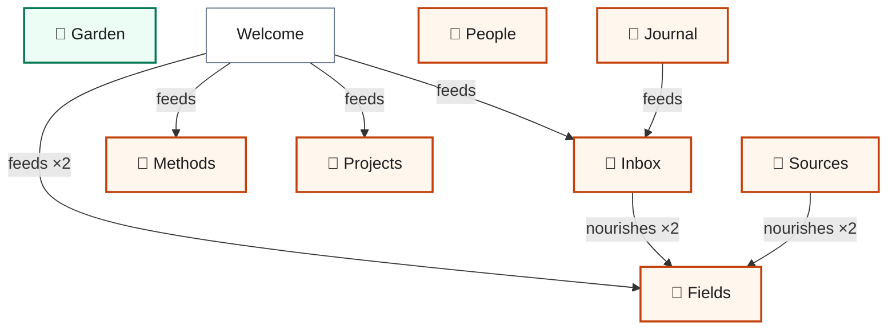
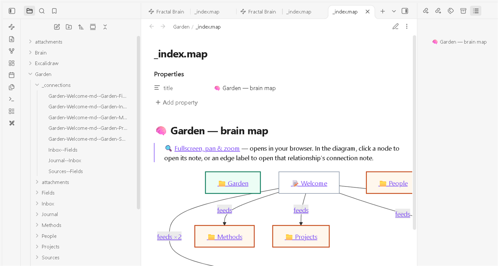
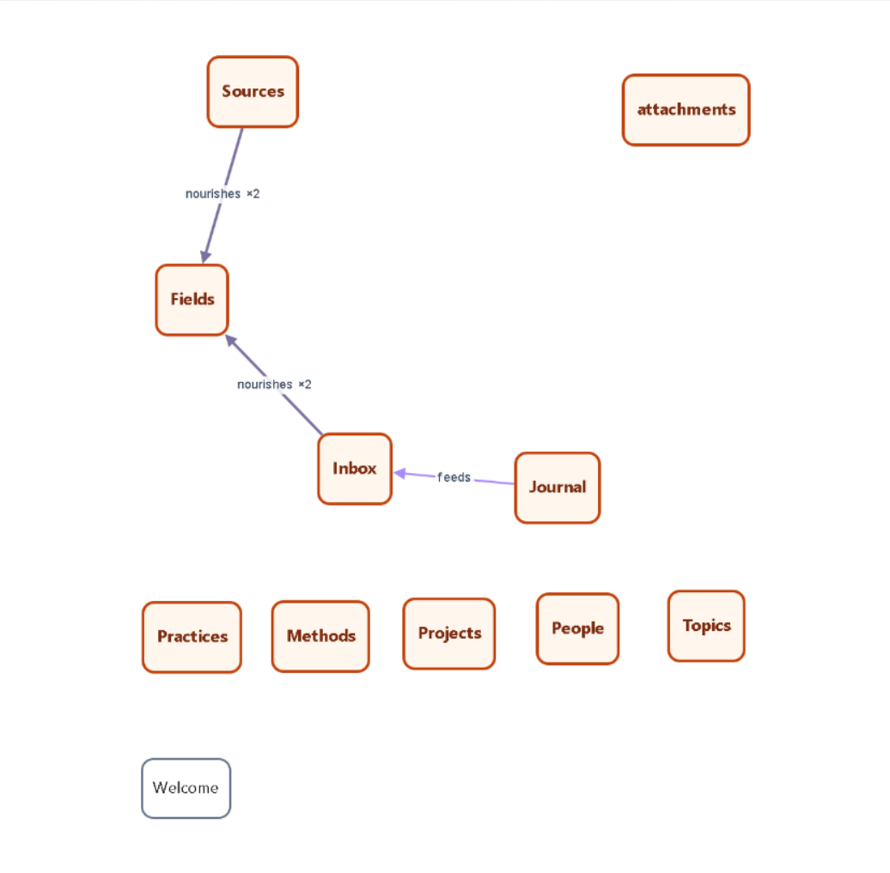
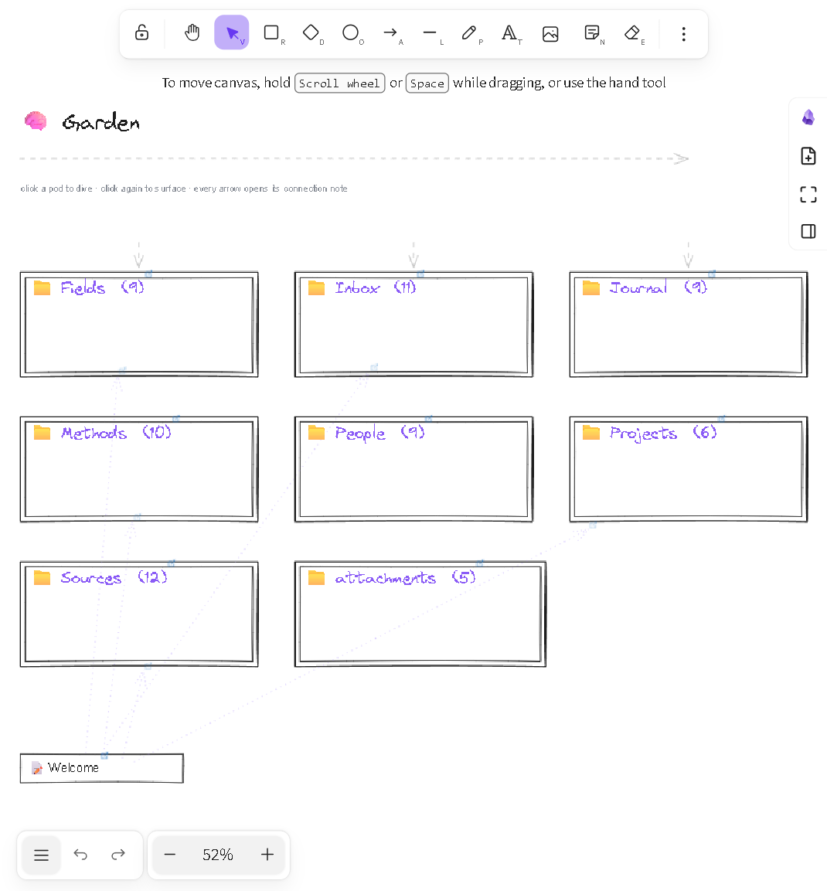
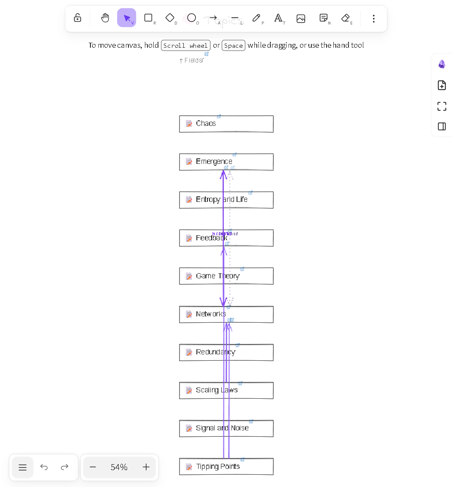

# Gallery

Every image below is generated or captured from the **real running system** in a
real vault — no mockups. Reproduce any of them: open a folder's brain map, or
install the plugin and hit the waypoints ribbon icon.

---

## The brain map that renders anywhere

Generated per folder as `_index.map.md` — the diagram above is the actual
file's Mermaid source, unchanged. Typed labeled edges; parallel relationships
(`feeds ×2`, `nourishes ×2`) render as separate curves. Renders natively in
Obsidian, on GitHub, and in the fullscreen `_index.map.html` runtime with
pan/zoom.

The same file opened in Obsidian — reading mode renders it natively.

---

## The Fractal Brain view

The live graph over the notes: folders as expandable clusters, typed colored
edges from connection notes, inferred wikilinks as dashed grey. Click a note to
open it; click an edge to open that relationship's connection note; double-click
a folder to expand it; full screen stays inside Obsidian.

Expand all, dive into the Fields cluster, then click the Inbox → Fields edge:
its connection note opens beside the graph, properties and explanation visible.

---

## Excalidraw maps — the hand-arrangeable canvas

### Garden — root overview

Eight folders as clean pods, Welcome as a card, the strongest relationships
drawn between pods, one legend line up top. Positions are stable: regenerate
any time, nothing you arranged moves.

### Topics — vertical contents, typed arrows

Ten atomic notes stacked like a contents list. The Emergence ⇄ Networks pair
carries **two parallel labeled arrows** (resonates + nourishes): two
relationships, two aspects, two lines. Arrows route alongside the column.
